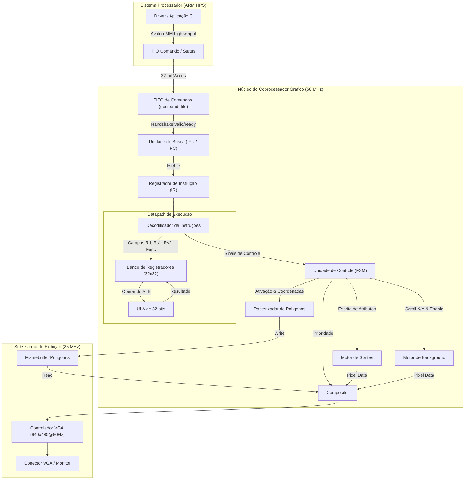

# Coprocessador Gráfico Programável em FPGA (ISA 32 bits)

**Problema #2 — 2026.2 | MI - Sistemas Digitais**  
*Universidade Estadual de Feira de Santana (UEFS)*  
*Departamento de Tecnologia (DTEC) — Engenharia de Computação*

---

## 1. Visão Geral do Projeto

Este projeto consiste no desenvolvimento, implementação e validação do núcleo de um **coprocessador gráfico de 32 bits em FPGA**, inspirado nas arquiteturas de consoles de 16/32 bits clássicos. O sistema integra módulos de aceleração gráfica por hardware (plano de fundo baseado em tiles, sprites e rasterizador de polígonos) a uma arquitetura de processamento programável baseada no ciclo clássico de busca e execução (*Fetch-Decode-Execute*), com unidade de controle, ULA, banco de registradores e interface de comunicação com o processador ARM Cortex-A9 (HPS - *Hard Processor System*) na plataforma **Terasic DE1-SoC (Cyclone V)**.

---

## 2. Levantamento de Requisitos

### 2.1 Requisitos Funcionais (RF)
* **RF01 - Arquitetura de Instruções (ISA) de 32 bits:** Todas as operações do coprocessador devem ser acionadas e parametrizadas exclusivamente por instruções de 32 bits.
* **RF02 - Ciclo de Busca e Execução:** Implementação dos estágios clássicos de processamento: Busca (*Fetch*), Decodificação (*Decode*), Execução (*Execute*) e Espera/Finalização (*Wait/Halt*).
* **RF03 - Unidade de Busca de Instruções (IFU):** Suporte à busca de instruções via FIFO de comandos síncrona (modo passivo alimentado pelo ARM/HPS) e suporte a execução sequencial com Program Counter (PC) e memória interna (modo ativo).
* **RF04 - Registrador de Instrução (IR):** Armazenamento estável da palavra de instrução durante as etapas de decodificação e controle.
* **RF05 - Decodificador de Instruções:** Reconhecimento dos opcodes primários e de extensão, extraindo de forma desacoplada os campos de registradores, dados imediatos, coordenadas de tela ($X, Y$), dimensões ($W, H$), atributos de sprites e paletas de cores.
* **RF06 - Unidade Lógica e Aritmética (ULA):** Realização de operações aritméticas (Soma, Subtração), lógicas (AND, OR, XOR), deslocamentos (SLL, SRL) e geração da flag `Zero`.
* **RF07 - Banco de Registradores:** 32 registradores de 32 bits, com portas duplas de leitura combinacional assíncrona, escrita síncrona habilitada por sinal de controle (`we`) e proteção por hardware para manter o registrador `R0` fixo em zero.
* **RF08 - Controle dos Motores Gráficos:**
  * **Motor de Background:** Controle de ativação/desativação (`SET_SCROLL`, `ERS_BACK`) e controle de deslocamento bidimensional contínuo (*scroll* $X, Y$).
  * **Motor de Sprites:** Posicionamento em coordenadas de pixel, movimentação dinâmica (`MV_SPRITE`), espelhamento horizontal/vertical, seleção de padrão de tile e desabilitação/remoção (`ERS_SPRITE`).
  * **Rasterizador de Polígonos:** Geração de retângulos preenchidos (`RECT`), triângulos com interpolação de vértices (`TRI`) e limpeza do framebuffer com transparência (`CLEAR`).
* **RF09 - Compositor de Vídeo e Prioridades:** Multiplexação pixel a pixel entre as camadas gráficas com suporte a alteração dinâmica da ordem de prioridade (`DFN_PRTY` / `MV_PRTY`).
* **RF10 - Controlador de Vídeo VGA:** Geração de sinais de sincronismo analógico VGA (640x480 @ 60 Hz) e pixel clock de 25 MHz de operação contínua e sem interrupções.
* **RF11 - Interface com ARM HPS:** Recepção de instruções e leitura de status (`empty`, `full`, `busy`, `done`) via ponte de interconexão *Lightweight HPS-to-FPGA* (Avalon-MM).
* **RF12 - Programa de Demonstração em Assembly:** Desenvolvimento de aplicação em código assembly próprio demonstrando a utilização conjunta da ULA, registradores e aceleradores gráficos.

### 2.2 Requisitos Não Funcionais (RNF)
* **RNF01 - Domínios de Clock e Temporização:** Frequência de operação do núcleo do coprocessador em 50 MHz e domínio do gerador de vídeo em 25 MHz, com tratamento de travessia de clock (*Clock Domain Crossing - CDC*).
* **RNF02 - Mecanismo de Comunicação Robusto:** Controle de fluxo estrito baseado em sinais de `valid`, `busy` e `done` para evitar corrupção de comandos e perda de dados.
* **RNF03 - Estabilidade de Exibição:** O gerador de sincronismo VGA e a unidade de controle de quadro devem rodar de forma contínua e desacoplada, garantindo ausência de flickering ou perda de sinal de vídeo durante a execução de instruções.
* **RNF04 - Eficiência de Recursos:** Síntese dentro da capacidade lógica e dos blocos de memória interna (M10K) da FPGA Cyclone V 5CSEMA5F31C6.

---

## 3. Arquitetura Proposta e Justificativa de Decisões



### 3.1 Justificativa das Decisões de Projeto

1. **Palavra de Instrução de 32 bits Fixa:**
   O espaço de 32 bits permite empacotar de forma regular e direta todas as informações necessárias para renderização gráfica: campos de coordenadas ($X \in [0, 319]$, 9 bits; $Y \in [0, 239]$, 8 bits), dimensões, identificadores de 32 sprites, espelhamento, seleção de tiles e opcodes sem necessidade de instruções de tamanho variável, o que simplifica o estágio de busca e decodificação em hardware.

2. **Decodificação Desacoplada da FSM:**
   O módulo [`rtl/instruction_decoder.v`](rtl/instruction_decoder.v) é puramente combinacional. Ele extrai os campos e aciona flags sem conhecer o ciclo de execução. A [`rtl/control_unit_32.v`](rtl/control_unit_32.v) apenas consome esses sinais, resultando em código modular, legível e testável isoladamente.

3. **Duplo Mecanismo de Busca (Passivo por FIFO vs Ativo por ROM/RAM):**
   * *Busca Passiva (FIFO):* O HPS escreve palavras de 32 bits em um periférico PIO que alimenta uma FIFO. O coprocessador consome as palavras conforme sua disponibilidade, permitindo ao processador ARM gerar cenas dinamicamente.
   * *Busca Ativa (PC):* O hardware lê o arquivo montado diretamente da memória interna inicializada (`game_program.hex`), possibilitando a demonstração autônoma do coprocessador na FPGA logo após o reset.

4. **Desacoplamento de Domínios de Clock (CDC):**
   A lógica de decodificação e rasterização opera no clock principal de **50 MHz** para maximizar o throughput de cálculo geométrico e execução da FSM. O subsistema de vídeo opera rigorosamente a **25 MHz** para cumprir o padrão VESA 640x480 @ 60 Hz. Os sinais de escrita em registradores de sprite, scroll e o framebuffer de polígonos possuem sincronização cuidadosa entre os dois domínios para evitar metaestabilidade.

---

### 3.2 Formato da ISA (Conjunto de Instruções de 32 bits)

A ISA utiliza os 4 bits mais significativos `[31:28]` como **Opcode Principal**. O Opcode `0x0` é reservado para **Instruções de Extensão**, cujo sub-opcode reside nos bits `[27:24]`.

| Instrução | Opcode / Sub-Op | Campos e Mapeamento de Bits | Descrição |
| :--- | :---: | :--- | :--- |
| `COLOR` | `0x1` | `[7:0]` = Código de cor (8 bits / RGB332) | Define a cor ativa para desenho de polígonos |
| `CLEAR` | `0x2` | Palavra fixa `0x20000000` | Limpa o framebuffer de polígonos com cor 0 (transparente) |
| `XY` | `0x3` | `[26:18]` = X (9 bits), `[17:10]` = Y (8 bits) | Define as coordenadas de referência |
| `WH` | `0x4` | `[26:18]` = Largura (9 bits), `[17:10]` = Altura (8 bits) | Define as dimensões do retângulo |
| `RECT` | `0x5` | Palavra fixa `0x50000000` | Inicia o desenho do retângulo com a cor e dimensões atuais |
| `TRI` | `0x6` | Palavra fixa `0x60000000` | Inicia o desenho do triângulo usando XY (V0), T1 (V1) e T2 (V2) |
| `SET_SPRITE` | `0x7` | `[27:23]` = ID, `[22:14]` = X, `[13:6]` = Y, `[5:4]` = Mirror, `[3:0]` = Tile | Inicializa/configura os atributos do sprite selecionado |
| `T1` | `0x8` | `[26:18]` = X1 (9 bits), `[17:10]` = Y1 (8 bits) | Define as coordenadas do vértice 1 do triângulo |
| `T2` | `0x9` | `[26:18]` = X2 (9 bits), `[17:10]` = Y2 (8 bits) | Define as coordenadas do vértice 2 do triângulo |
| `SET_SCROLL`| `0xB` | `[26:18]` = X, `[17:10]` = Y | Habilita o motor de fundo e define o scroll inicial |
| `MV_SPRITE` | `0xC` | `[27:23]` = ID, `[22:14]` = X, `[13:6]` = Y | Reposiciona o sprite sem alterar espelhamento ou tile |
| `ERS_SPRITE`| `0xD` | `[27:23]` = ID | Desabilita e apaga o sprite da tela |
| `MV_SCROLL` | `0xE` | `[26:18]` = X, `[17:10]` = Y | Altera o deslocamento do fundo mantendo seu estado habilitado |
| `HALT` | `0xF` | Palavra fixa `0xF0000000` | Sinaliza o término da cena (`scene_done = 1`) e interrompe a FSM |
| `ERS_BACK` | `0x0` / `0x1` | Sub-op `[27:24] = 0x1` | Desliga a camada de background |
| `DFN_PRTY` | `0x0` / `0x2` | Sub-op `[27:24] = 0x2`, `[1:0]` = Modo | Define a prioridade do compositor (0: Sprite>Poly>BG, etc.) |
| `MV_PRTY` | `0x0` / `0x3` | Sub-op `[27:24] = 0x3`, `[1:0]` = Modo | Altera a prioridade do compositor |
| `ALU_OP` | `0x0` / `0x4` | Sub-op `0x4`, `Rd[23:19]`, `Rs1[18:14]`, `Rs2[13:9]`, `Func[3:0]` | Executa operação da ULA entre registradores e grava em `Rd` |
| `LDI` | `0x0` / `0x5` | Sub-op `0x5`, `Rd[23:19]`, `Imm[18:0]` | Carrega valor imediato de 19 bits no registrador `Rd` |

---

## 4. Especificação do Hardware Utilizado

* **Placa de Desenvolvimento:** Terasic DE1-SoC (Revisão F)
* **Dispositivo FPGA:** Intel Cyclone V SoC — **5CSEMA5F31C6**
  * 85.000 Elementos Lógicos equivalentes (~32.070 ALMs)
  * 4.065.280 bits de memória M10K embarcada
  * 6 PLLs fracionários
* **Processador Hard Processor System (HPS):**
  * Dual-Core ARM Cortex-A9 MPCore operando a 800 MHz
  * Barramento de interconexão AXI / Avalon-MM (Lightweight Bridge em `0xFF200000`)
* **Interface de Vídeo:**
  * Conector DB15 VGA padrão, alimentado pelo DAC de vídeo ADV7123 de 24 bits (8 bits por canal R, G, B)
* **Ferramental de Software:**
  * Intel Quartus Prime Lite Edition 25.1 / 20.1
  * Questa / ModelSim Intel FPGA Starter Edition 2025.2
  * Compilador Cruzado GCC (`arm-linux-gnueabihf-gcc`)

---

## 5. Estrutura de Verificação e Testes

A verificação do sistema é composta por testbenches modulares autocontidos para cada unidade principal do Problema 2 e um testbench de integração completa.

### 5.1 Testbenches Implementados

* [`tb/tb_alu_32.v`](tb/tb_alu_32.v): Valida as 8 operações aritméticas e lógicas, limites de overflow/subtração e flag Zero.
* [`tb/tb_register_file.v`](tb/tb_register_file.v): Testa leitura assíncrona simultânea em 2 portas, escrita síncrona com `we` e confirma que escritas em `R0` são descartadas por hardware.
* [`tb/tb_gpu_cmd_fifo.v`](tb/tb_gpu_cmd_fifo.v): Verifica fluxo FIFO, estado vazio após reset, transição para cheio (`full`), proteção contra escrita excessiva e ordenação exata dos dados na saída.
* [`tb/tb_instruction_fetch_unit.v`](tb/tb_instruction_fetch_unit.v): Testa o protocolo de handshake `valid/ready` com a FIFO de comandos.
* [`tb/tb_instruction_register.v`](tb/tb_instruction_register.v): Verifica o travamento seguro da instrução na borda de subida do clock e retenção estável de valor quando `load_ir = 0`.
* [`tb/tb_instruction_decoder.v`](tb/tb_instruction_decoder.v): Executa bateria de testes cobrindo todas as instruções da ISA, garantindo a correta separação de opcodes primários, extensões, imediatos e coordenadas.
* [`tb/tb_control_unit_32.v`](tb/tb_control_unit_32.v): Simula o pipeline de estados (`FETCH` → `DECODE` → `EXEC` → `WAIT` → `HALT`), comunicação com o rasterizador e disparo dos sinais de escrita dos motores de sprites e fundo.
* [`tb/tb_coprocessador_integrado.v`](tb/tb_coprocessador_integrado.v): **Testbench de Integração Geral**. Instancia o top-level do coprocessador (`test_top`), alimenta uma sequência real de comandos pelo barramento do ARM HPS, valida a renderização gráfica, controle de prioridades, terminação com `HALT` e geração ininterrupta dos sinais VGA.

### 5.2 Scripts de Automação de Simulação

Para compilar e executar toda a suíte de testes de forma automatizada:

* **Pelo ModelSim / QuestaSim (GUI ou Linha de Comando):**
  ```tcl
  do tb/run_sim.do
  vsim work.tb_coprocessador_integrado
  add wave -r /*
  run -all
  ```
* **Pelo Windows (Script Batch):**
  Basta dar um duplo clique ou executar no terminal:
  ```cmd
  tb\run_all.bat
  ```

---

## 6. Resultados de Simulação e Demonstração em Hardware

### 6.1 Resultados de Simulação
Todos os testbenches executam rotinas de verificação automática (*self-checking*) com mensagens formatadas de `[PASS]` e contadores de erro. No testbench integrado [`tb/tb_coprocessador_integrado.v`](tb/tb_coprocessador_integrado.v), a fila de comandos é drenada integralmente, o sinal `gpu_done` é ativado em sincronismo com o comando `HALT`, e os sincronismos horizontal e vertical do VGA mantêm-se rigorosamente dentro dos padrões de temporização VESA.

### 6.2 Demonstração em Hardware (Placa DE1-SoC)

A demonstração do coprocessador na placa física pode ser realizada de duas formas:
1. **Modo Autônomo / Busca Ativa (Demonstração Imediata na Placa):**
   Com o hardware configurado, a FPGA executa o programa gráfico carregado de [`data/game_program.hex`](data/game_program.hex) imediatamente após o reset (KEY0), desenhando no monitor VGA:
   * Limpeza de fundo;
   * Sol retangular amarelo no topo da tela;
   * Montanhas triangulares vermelhas renderizadas pelo rasterizador de polígonos;
   * Nuvens brancas retangulares;
   * Sprites animados (cavaleiro e blocos) com espelhamento horizontal;
   * Plano de fundo com rolagem contínua (*scrolling*).
2. **Modo Controlado pelo ARM HPS via Linux:**
   Executando o aplicativo interativo [`sw/menu_gpu.c`](sw/menu_gpu.c) ou [`sw/run_program.c`](sw/run_program.c), o usuário pode enviar instruções em tempo real via terminal Linux conectado à porta serial/SSH da DE1-SoC.

---

## 7. Análise de Síntese, Recursos e Timing

Dados reais extraídos dos relatórios de compilação do Quartus Prime (`soc_system.fit.summary` e `soc_system.sta.summary`):

### 7.1 Utilização de Recursos da FPGA (Cyclone V 5CSEMA5F31C6)

| Recurso | Utilizado | Total Disponível | Porcentagem (%) |
| :--- | :---: | :---: | :---: |
| **Módulos Lógicos (ALMs)** | **4.711** | 32.070 | **15%** |
| **Registradores de Hardware** | **5.248** | — | — |
| **Pinos de I/O** | **382** | 457 | **84%** |
| **Memória de Bloco (Bits M10K)** | **2.543.488** | 4.065.280 | **63%** |
| **Blocos de Memória RAM (M10K)** | **319** | 397 | **80%** |
| **Blocos de Multiplicação DSP** | **3** | 87 | **3%** |
| **Total de DLLs** | **1** | 4 | **25%** |

> **Observação:** O maior uso de recursos concentra-se nos blocos de memória interna M10K (80%), devido à instanciação do framebuffer de polígonos (320x240 pixels), da ROM de imagem de fundo e das tabelas de padrões e tiles dos sprites.

### 7.2 Análise de Temporização e Frequência Máxima (Timing Analyzer)

* **Domínio de Clock do Núcleo (50 MHz - `clock_50_1`):**
  * *Slack de Setup (Slow 1100mV 85C):* **+8.696 ns** (Margem ampla, frequência máxima teórica superior a **100 MHz**).
  * *Slack de Hold:* **+0.290 ns** (Sem violações de corrida).
* **Domínio da Memória DDR3/HPS (`afi_clk_write_clk`):**
  * *Slack de Setup:* **+1.730 ns** (Temporização atendida com sucesso).
* **Domínio do Gerador VGA (25 MHz - `clk_25mhz`):**
  * *Período de Clock:* 40.0 ns.
  * O sinal opera desacoplado do pipeline da CPU gráfica, assegurando estabilidade na varredura da tela.

### 7.3 Gargalos Identificados e Oportunidades de Melhoria

* **Gargalo no Preenchimento do Rasterizador:**  
  Durante a execução de instruções de desenho geométrico (`RECT` e `TRI`), a FSM da Unidade de Controle entra no estado de espera `S_WAIT` até que o sinal `rast_done` seja ativado. Isso significa que o pipeline de busca e decodificação pausa temporariamente enquanto os pixels são calculados e gravados sequencialmente no framebuffer de polígonos.  
  *Melhoria possível:* Implementar uma fila de comandos assíncrona dedicada ao rasterizador de polígonos, permitindo que a CPU gráfica continue executando operações lógicas/aritméticas da ULA e comandos de sprites em paralelo enquanto o rasterizador preenche a geometria em segundo plano.

---

## 8. Indicação Explícita de Funcionalidades Não Atendidas

Em atendimento às normas de transparência da Seção 5:

1. **Controle Dinâmico de Start/Reset da Busca Ativa via Barramento ARM:**  
   O modo de busca ativa atual opera de maneira autônoma com o sinal `run_program = 1'b1`, iniciando imediatamente após o reset da placa e lendo a memória inicializada. O modelo de driver [`sw/driver_arm_busca_ativa.S`](sw/driver_arm_busca_ativa.S) atua como referência de arquitetura para a equipe, mas o controle de disparo interativo em tempo de execução a partir do Linux é realizado atualmente através do modo de **Busca Passiva** (pelo envio sequencial de palavras via interface MMIO com [`sw/menu_gpu.c`](sw/menu_gpu.c)), o qual atende integralmente à comunicação de software do problema.

---

## 9. Como Reproduzir o Projeto

> [!NOTE]
> **Requisito de Ambiente (Linux / WSL):**  
> Para trabalhar com o ecossistema SoC da Cyclone V (geração de scripts de HPS, preloader, compilação de código ARM ou execução de ferramentas auxiliares do Quartus), é **necessário utilizar um ambiente Linux ou WSL (Windows Subsystem for Linux)**, pois comandos de terminal Linux são requeridos para a preparação dos fluxos do HPS e para a compilação dos softwares.

### 9.1 Compilação do Hardware e Gravação na Placa DE1-SoC

1. Abra o arquivo de projeto [`soc_system.qpf`](soc_system.qpf) no **Intel Quartus Prime**.
2. Caso realize alterações no sistema do processador, abra o Platform Designer (`soc_system.qsys`) e clique em *Generate HDL*.
3. Execute a compilação completa do projeto (*Processing* → *Start Compilation*).
4. Conecte a placa DE1-SoC ao computador via cabo USB (*USB-Blaster II*) e ligue a alimentação.
5. Abra o **Quartus Programmer**, clique em *Auto Detect*, selecione o arquivo compilado [`output_files/soc_system.sof`](output_files/soc_system.sof) e clique em *Start* para gravar a FPGA.
6. Conecte um monitor à saída VGA da placa.

---

### 9.2 Transferência e Execução do Software na DE1-SoC (Linux HPS)

Para controlar o coprocessador interativamente e rodar o menu gráfico, é necessário transferir os seguintes arquivos para a placa:

| Arquivo | Origem no Projeto | Descrição |
| :--- | :--- | :--- |
| **`menu_gpu.c`** | [`sw/menu_gpu.c`](sw/menu_gpu.c) | Aplicação em C que gerencia o menu interativo no terminal e envia comandos via MMIO |
| **`run_program.c`** | [`sw/run_program.c`](sw/run_program.c) | Script executável para envio sequencial automático da cena de demonstração |
| **`game_program.hex`** | [`data/game_program.hex`](data/game_program.hex) | Código de máquina montado da demonstração gráfica |
| **`game_program.asm`** | [`data/game_program.asm`](data/game_program.asm) | Código-fonte em assembly próprio (para testes e inspeção) |

#### Passo 1: Transferir os arquivos para a placa
Com a DE1-SoC conectada à rede local (Ethernet) ou usando um pendrive USB montado no Linux embarcado, copie os arquivos para a pasta do usuário (ex: `/home/root`):

```bash
# Executado no seu PC/WSL apontando para o IP da placa DE1-SoC:
scp sw/menu_gpu.c sw/run_program.c data/game_program.hex data/game_program.asm root@<IP_DA_PLACA>:/home/root/
```

#### Passo 2: Acessar o terminal da DE1-SoC
Acesse a placa via terminal serial (PuTTY / Minicom / `screen /dev/ttyUSB0 115200`) ou via SSH:

```bash
ssh root@<IP_DA_PLACA>
cd /home/root
```

#### Passo 3: Habilitar a Ponte HPS-to-FPGA
Antes de enviar instruções, é fundamental habilitar o barramento de comunicação Lightweight entre o processador ARM e a FPGA:

```bash
echo 1 > /sys/class/fpga-bridge/lwhps2fpga/enable
```

#### Passo 4: Compilar os programas nativamente na placa
No próprio terminal da placa, compile os códigos C utilizando o GCC instalado no Linux da DE1-SoC:

```bash
gcc -O2 -Wall -o menu_gpu menu_gpu.c
gcc -O2 -Wall -o run_program run_program.c
```

*(Alternativamente, é possível realizar a compilação cruzada no seu computador/WSL com `arm-linux-gnueabihf-gcc` e transferir os binários prontos).*

#### Passo 5: Executar o Menu Interativo
Execute o menu para controlar o coprocessador em tempo real:

```bash
# Modo 1: Menu interativo completo
./menu_gpu

# Modo 2: Carregando um programa pré-montado e abrindo o menu em seguida
./menu_gpu game_program.hex

# Modo 3: Envio direto do script de demonstração montado
./run_program
```

---

### 9.3 Solução de Problemas Conhecidos: Erro de Compilação HPS SDRAM no Windows (`hps_AC_ROM.hex` / WSL)

#### Sintoma do Erro no Quartus Prime:
Ao compilar o projeto ou gerar o Qsys no Windows, o processo é abortado com mensagens semelhantes a:
```text
Error (12252): Border: Error during execution of "{.../nios2eds/Nios II Command Shell.bat} make all 2>> stderr.txt": child process exited abnormally
Error (12252): Border: Nios II Command Shell.bat requires Windows Subsystem for Linux (WSL) to run.
Error (12252): Border: Please install WSL and try again.
Error (12252): Border: add_fileset_file: No such file .../0004_seq_gen/hps_AC_ROM.hex
```

#### Causa Técnica:
O controlador de memória DDR3 do HPS da Cyclone V (`altera_mem_if_ddr3_hard_phy_core`) utiliza um sequenciador de calibração cuja ROM de microcódigo (`hps_AC_ROM.hex`) é gerada dinamicamente durante a compilação/síntese através da execução do comando `make all`. Nas versões recentes do Quartus Prime para Windows, a Intel descontinuou o ambiente Cygwin interno e delegou a execução de scripts de compilação POSIX ao **WSL (Windows Subsystem for Linux)**. Se o WSL não estiver instalado ou se não possuir os utilitários `make` e `dos2unix`, a geração da ROM falha e o Quartus interrompe a síntese.

#### Procedimento de Resolução no Windows:

1. **Instalar o WSL (Ubuntu) pelo PowerShell:**
   Abra o **PowerShell como Administrador** e execute:
   ```powershell
   wsl --install -d Ubuntu
   ```
   *(Caso o computador solicite reinicialização, reinicie para concluir).*

2. **Instalar as dependências essenciais dentro do WSL:**
   Abra o aplicativo **Ubuntu** (terminal do WSL) e instale os pacotes exigidos pelo Quartus:
   ```bash
   sudo apt update
   sudo apt install -y make dos2unix build-essential
   ```

3. **Ajuste de Versão do WSL (Caso persista):**
   Algumas versões do Quartus Prime exigem compatibilidade com o formato de caminhos do WSL 1. Se o erro continuar ocorrendo com o WSL 2, abra o PowerShell como Administrador e converta a distribuição para WSL 1:
   ```powershell
   wsl --set-version Ubuntu 1
   ```

4. **Recompilar no Quartus Prime:**
   Feche e reabra o Quartus Prime. Ao reiniciar a compilação (*Start Compilation*), o `Nios II Command Shell.bat` encontrará o WSL e o utilitário `make`, gerando o `hps_AC_ROM.hex` com sucesso e concluindo a síntese da FPGA.

